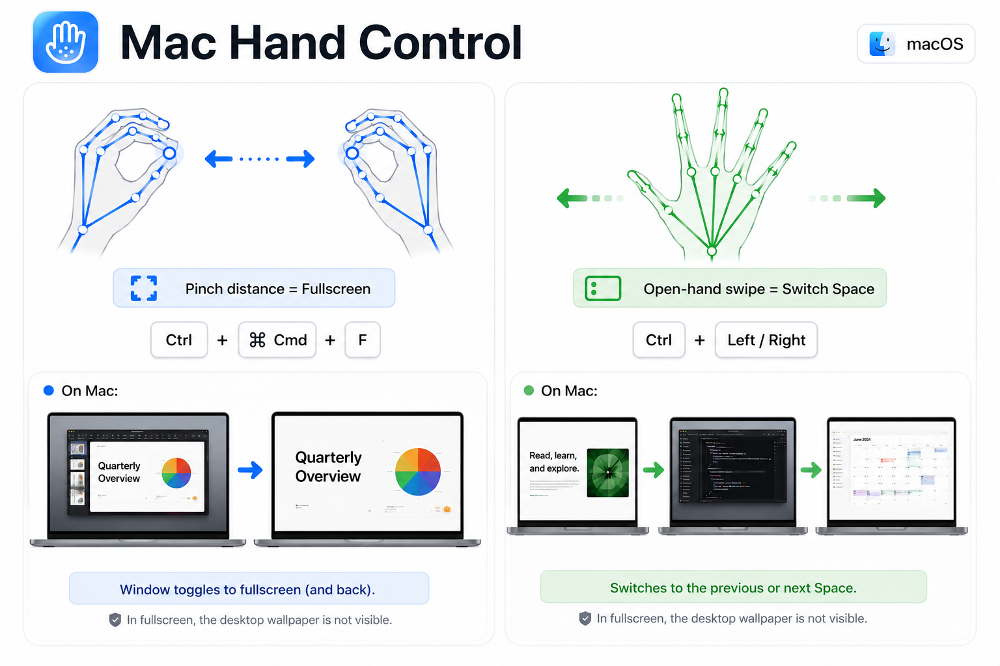
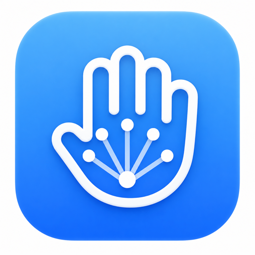

<p align="center">
  <a href="https://github.com/minwoo19930301/mac-hand-control/releases/latest/download/Mac-Hand-Controller.dmg"></a>
</p>

# Mac Hand Controller

Control your Mac with hand gestures in front of the camera.

<table>
  <tr>
    <td width="70%"></td>
    <td width="30%" align="center"></td>
  </tr>
</table>

## Gestures

| Gesture | Action |
| --- | --- |
| Pinch with both hands, then spread or squeeze | Toggle fullscreen (`Ctrl + Cmd + F`) |
| Open palm, swipe left or right | Switch Space (`Ctrl + ←/→`) |
| Make an L with thumb and index finger | Move the pointer |
| Pinch while pointing | Left click |
| Double pinch while pointing | Right click |
| Make a fist and move up or down | Scroll |

Each gesture can be turned off in the app.

## Install

1. Click **DOWNLOAD DMG** above.
2. Open the DMG and drag `Mac Hand Controller.app` into `Applications`.
3. Launch it, allow camera access, and turn on Accessibility from the in-app setup panel.

It's not notarized. If macOS blocks it, go to System Settings → Privacy & Security and click **Open Anyway**.

## Build

```sh
./build.sh     # build/Mac Hand Controller.app
./package.sh   # dist/Mac-Hand-Controller.dmg
```

For a signed and notarized release, see `release.sh`.
